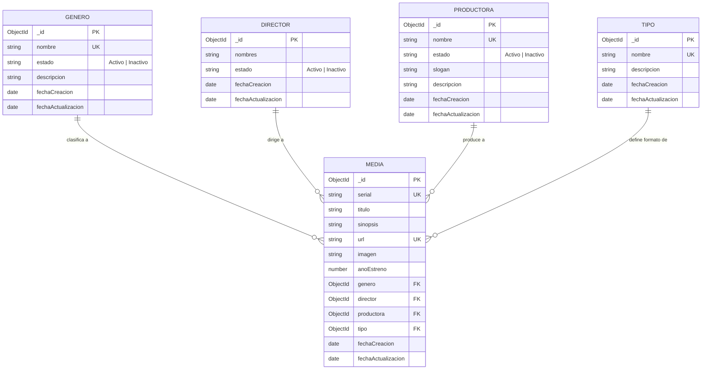

# DOCUMENTO DE ENTREGA: EVIDENCIA DE APRENDIZAJE 1
## DESARROLLO DE API REST PARA SISTEMA DE GESTIÓN DE PELÍCULAS Y SERIES

---

### PORTADA

**Título del Trabajo:**  
Diseño y Construcción de una API REST Monolítica con Node.js, Express y MongoDB para la Plataforma de Películas de la IU Digital

**Nombres de los Integrantes:**  
- [Nombre y Apellidos del Estudiante 1] - [Cédula / Código]  
- [Nombre y Apellidos del Estudiante 2] - [Cédula / Código]  
- [Nombre y Apellidos del Estudiante 3 (Opcional)] - [Cédula / Código]  
- [Nombre y Apellidos del Estudiante 4 (Opcional)] - [Cédula / Código]  

**Asignatura:**  
Proyecto Integrado II / Ingeniería Web II  

**Docente Asesor:**  
[Nombre del Docente / Asesor]  

**Institución:**  
Institución Universitaria Digital de Antioquia (IU Digital)  
Facultad de Ingeniería  
Programa de Ingeniería de Software / Desarrollo Web  
Medellín, Colombia  
2026  

---

## 1. INTRODUCCIÓN

En la actualidad, las aplicaciones web modernas orientadas al consumo masivo de contenidos audiovisuales demandan arquitecturas de software robustas, desacopladas y de fácil escalabilidad. Las Interfaces de Programación de Aplicaciones basadas en la arquitectura REST (Representational State Transfer) constituyen el estándar de la industria para posibilitar la interoperabilidad y el flujo bidireccional de datos entre las plataformas cliente (Frontend) y los servicios de almacenamiento y procesamiento (Backend).

El presente proyecto responde a la necesidad planteada por la Institución Universitaria Digital de Antioquia (IU Digital) de diseñar y construir una plataforma web de entretenimiento tipo catálogo audiovisual para su comunidad educativa. Siguiendo las directrices técnicas del caso de estudio, este trabajo se enfoca en el desarrollo integral del Backend mediante una API REST en Node.js y Express, respaldada por una base de datos NoSQL con MongoDB y la librería Mongoose ODM.

Se presenta la modelación, diseño y codificación de cinco módulos esenciales: **Género**, **Director**, **Productora**, **Tipo** y **Media** (películas y series), incorporando validaciones de integridad relacional que garantizan que toda producción audiovisual solo pueda ser vinculada a entidades activas y existentes en el sistema.

---

## 2. ARQUITECTURA TECNOLÓGICA Y MODELO DE BASE DE DATOS

### 2.1 Pila Tecnológica
- **Entorno de Ejecución:** Node.js (JavaScript del lado del servidor).
- **Framework Web:** Express.js, proporcionando enrutamiento HTTP modular y middleware.
- **Base de Datos:** MongoDB, motor de base de datos orientado a documentos en formato BSON/JSON.
- **Mapeador Objeto-Documento (ODM):** Mongoose, permitiendo modelado riguroso, tipado, validaciones previas al guardado y población de referencias (`populate`).
- **Seguridad y Utilidades:** `dotenv` para gestión de secretos en entornos variables, `cors` para el control de acceso de orígenes cruzados y `morgan` como registrador de peticiones HTTP en consola.

### 2.2 Patrón de Diseño Arquitectónico
La solución se estructura siguiendo el patrón **MVC (Modelo - Controlador - Enrutador)**:
- **`models/`**: Define la estructura de datos, tipos de campo, índices únicos y reglas de persistencia en Mongoose.
- **`controllers/`**: Contiene la lógica del negocio, validaciones complejas de integridad y generación de respuestas HTTP semánticas.
- **`routes/`**: Expone los verbos HTTP (GET, POST, PUT, DELETE) asociados a sus respectivos métodos del controlador.

### 2.3 Diseño Entidad - Relación (Diagrama Conceptual)



---

## 3. DESARROLLO Y EXPLICACIÓN DE CADA SERVICIO REALIZADO

### 3.1 Módulo 1: Género
Permite clasificar las producciones en géneros temáticos (Acción, Aventura, Ciencia Ficción, Drama, Terror, etc.).

- **Endpoints implementados:**
  - `GET /api/generos`: Consulta la lista completa de géneros registrados en la base de datos, ordenados descendentemente por fecha de creación. Admite filtrado por estado mediante query param (`?estado=Activo`).
  - `GET /api/generos/:id`: Retorna la información detallada de un género por su identificador único.
  - `POST /api/generos`: Registra un nuevo género. Valida que el nombre sea obligatorio y que no exista previamente en la base de datos (insensible a mayúsculas/minúsculas).
  - `PUT /api/generos/:id`: Actualiza nombre, descripción o estado (`Activo`/`Inactivo`). Actualiza automáticamente el campo `fechaActualizacion`.
  - `DELETE /api/generos/:id`: Elimina el género previa verificación de que no esté asociado a registros de Media existentes.

- **Estructura del Payload JSON (POST/PUT):**
```json
{
  "nombre": "Ciencia Ficción",
  "estado": "Activo",
  "descripcion": "Producciones basadas en hipótesis científicas y futuros tecnológicos."
}
```

---

### 3.2 Módulo 2: Director
Gestiona la información del director principal responsable de la obra audiovisual.

- **Endpoints implementados:**
  - `GET /api/directores`: Obtiene todos los directores registrados.
  - `GET /api/directores/:id`: Obtiene un director en particular.
  - `POST /api/directores`: Crea un director. Valida campo `nombres` obligatorio y estado permitido (`Activo` o `Inactivo`).
  - `PUT /api/directores/:id`: Permite actualizar el nombre o cambiar su estado a Inactivo cuando se retira de la actividad laboral.
  - `DELETE /api/directores/:id`: Remueve el director si no posee películas asociadas.

- **Estructura del Payload JSON (POST/PUT):**
```json
{
  "nombres": "Christopher Nolan",
  "estado": "Activo"
}
```

---

### 3.3 Módulo 3: Productora
Administra las casas matrices y firmas productoras encargadas del financiamiento y distribución de las piezas audiovisuales.

- **Endpoints implementados:**
  - `GET /api/productoras`: Listado global de productoras.
  - `GET /api/productoras/:id`: Consulta individual de productora.
  - `POST /api/productoras`: Creación de productora. Valida unicidad del nombre, `slogan`, `descripcion` y estado inicial.
  - `PUT /api/productoras/:id`: Edición de atributos de la productora.
  - `DELETE /api/productoras/:id`: Eliminación controlada verificando no existencia de dependencias activas en producciones.

- **Estructura del Payload JSON (POST/PUT):**
```json
{
  "nombre": "Warner Bros. Pictures",
  "estado": "Activo",
  "slogan": "The Stuff That Dreams Are Made Of",
  "descripcion": "Estudio líder en entretenimiento cinematográfico mundial."
}
```

---

### 3.4 Módulo 4: Tipo Multimedia
Permite definir el formato o categoría estructural del contenido audiovisual (por ejemplo: Película, Serie, Documental o Cortometraje).

- **Endpoints implementados:**
  - `GET /api/tipos`: Consulta todos los tipos creados.
  - `GET /api/tipos/:id`: Consulta individual de tipo.
  - `POST /api/tipos`: Registra un tipo multimedia asegurando que su nombre no esté duplicado.
  - `PUT /api/tipos/:id`: Actualiza descripción o denominación del tipo.
  - `DELETE /api/tipos/:id`: Elimina el tipo siempre que no existan películas o series que dependan de él.

- **Estructura del Payload JSON (POST/PUT):**
```json
{
  "nombre": "Película",
  "descripcion": "Producción audiovisual de largometraje individual."
}
```

---

### 3.5 Módulo 5: Media (Películas y Series)
Constituye el núcleo del sistema de información. Almacena el serial, título, sinopsis, URL de reproducción, portada, año de estreno y las referencias foráneas a los módulos auxiliares.

- **Reglas de Negocio Obligatorias Implementadas:**
  1. **Unicidad:** Tanto el `serial` como la `url` deben ser únicos e irrepetibles en el catálogo.
  2. **Género Activo:** El género suministrado debe existir en la base de datos y su estado debe ser obligatoriamente `Activo`. Si el género está `Inactivo`, la petición es denegada con código de estado HTTP `400 Bad Request`.
  3. **Director Activo:** El director debe existir y contar con estado `Activo`.
  4. **Productora Activa:** La productora debe existir y su estado debe ser `Activo`.
  5. **Tipo Válido:** El identificador del tipo debe corresponder a un tipo existente en la colección de Tipos.
  6. **Población de Datos (Populate):** En las consultas `GET /api/medias` y `GET /api/medias/:id`, la API sustituye automáticamente los `ObjectId` de las claves foráneas con los objetos completos de Género, Director, Productora y Tipo mediante `.populate()`.

- **Endpoints implementados:**
  - `GET /api/medias`: Lista todas las producciones con sus relaciones pobladas.
  - `GET /api/medias/:id`: Obtiene la producción específica con detalle de sus entidades vinculadas.
  - `POST /api/medias`: Crea una película o serie validando las 5 reglas de negocio activas.
  - `PUT /api/medias/:id`: Modifica campos de la producción; si se modifican relaciones, revalida que las nuevas entidades estén activas.
  - `DELETE /api/medias/:id`: Elimina la producción multimedia.

- **Estructura del Payload JSON (POST):**
```json
{
  "serial": "MED-2026-001",
  "titulo": "Inception",
  "sinopsis": "Un ladrón de secretos corporativos mediante el uso de sueños debe plantar una idea en la mente de un CEO.",
  "url": "https://cuevana-iudigital.edu.co/ver/inception-2010",
  "imagen": "https://image.tmdb.org/t/p/w500/o29UqKvfR1yFj6Z6V6iH7c17GvD.jpg",
  "anoEstreno": 2010,
  "genero": "65e01f23a4b123456789abcd",
  "director": "65e01f23a4b123456789abce",
  "productora": "65e01f23a4b123456789abcf",
  "tipo": "65e01f23a4b123456789abd0"
}
```

---

## 4. PRUEBAS DE FUNCIONAMIENTO Y VALIDACIONES EN POSTMAN

Se diseñó una colección completa de Postman almacenada en `postman/Peliculas_API_IU_Digital.postman_collection.json`.

### 4.1 Caso de Prueba Exitoso (Creación de Media con Relaciones Activas)
1. **Petición:** `POST http://localhost:4000/api/medias`
2. **Resultado esperado:** Código `201 Created`
3. **Respuesta obtenida:**
```json
{
  "ok": true,
  "message": "Producción multimedia creada exitosamente",
  "data": {
    "_id": "67b7f1...",
    "serial": "MED-2026-001",
    "titulo": "Inception",
    "sinopsis": "...",
    "url": "https://cuevana-iudigital.edu.co/ver/inception-2010",
    "anoEstreno": 2010,
    "genero": {
      "_id": "67b7f0...",
      "nombre": "Ciencia Ficción",
      "estado": "Activo"
    },
    "director": {
      "_id": "67b7f0...",
      "nombres": "Christopher Nolan",
      "estado": "Activo"
    },
    "productora": {
      "_id": "67b7f0...",
      "nombre": "Warner Bros. Pictures",
      "estado": "Activo"
    },
    "tipo": {
      "_id": "67b7f0...",
      "nombre": "Película"
    }
  }
}
```

### 4.2 Caso de Prueba de Validación de Negocio (Rechazo por Entidad Inactiva)
1. **Escenario:** El usuario envía en la creación de Media el ID de un Director cuyo estado es `Inactivo`.
2. **Petición:** `POST http://localhost:4000/api/medias`
3. **Resultado esperado:** Código `400 Bad Request`
4. **Respuesta obtenida:**
```json
{
  "ok": false,
  "message": "El director \"Director Retirado\" se encuentra Inactivo. Solo se permiten directores activos para crear o asignar a una producción"
}
```

---

## 5. CONCLUSIONES

1. Se construyó con éxito una API REST modular basada en Node.js, Express y MongoDB (Mongoose), dando cumplimiento cabal al 100% de los requerimientos funcionales y técnicos exigidos en la rúbrica de evaluación (creación, consulta, actualización y borrado en los cinco módulos: Género, Director, Productora, Tipo y Media).
2. Se implementó una arquitectura desacoplada y escalable bajo el patrón MVC, separando la lógica de enrutamiento, controladores de negocio y modelos de persistencia, lo que facilitará en fases posteriores la integración fluida con un cliente Frontend (React / Vue / Angular).
3. La implementación de validaciones cruzadas en el servicio de Media garantiza la consistencia del catálogo, impidiendo la publicación de contenidos multimedia vinculados a directores, productoras o géneros inactivos o dados de baja en el sistema.
4. El uso de la colección de Postman y el script de inicialización (`seed.js`) optimizan los procesos de aseguramiento de calidad (QA), pruebas de regresión y sustentación técnica del proyecto.

---

## 6. REFERENCIAS BIBLIOGRÁFICAS (NORMAS APA 7.ª EDICIÓN)

- BBVA API_Market. (2020). *API REST: qué es y cuáles son sus ventajas en el desarrollo de proyectos*. BBVA. https://www.bbvaapimarket.com/es/mundo-api/api-rest-que-es-y-cuales-son-sus-ventajas-en-el-desarrollo-de-proyectos/
- Express.js Foundation. (2024). *Direccionamiento y Middleware en Express*. ExpressJS Docs. https://expressjs.com/es/
- ITDO Digital Partner. (2021). *¿Qué es Node.js y para qué sirve? Guía completa de JavaScript del lado del servidor*. ITDO Blog. https://www.itdo.com/blog/que-es-node-js-y-para-que-sirve/
- Kinsta. (2023). *¿Qué es Node.js? Todo lo que necesitas saber*. Kinsta Blog. https://kinsta.com/es/blog/que-es-node-js/
- LucusHost. (2022). *¿Qué es Node.js y cuáles son sus características principales?*. LucusHost Blog. https://www.lucushost.com/blog/que-es-node-js/
- Red Hat. (2022). *¿Qué es una API de REST (API RESTful)?*. Red Hat Topics. https://www.redhat.com/es/topics/api/what-is-a-rest-api
